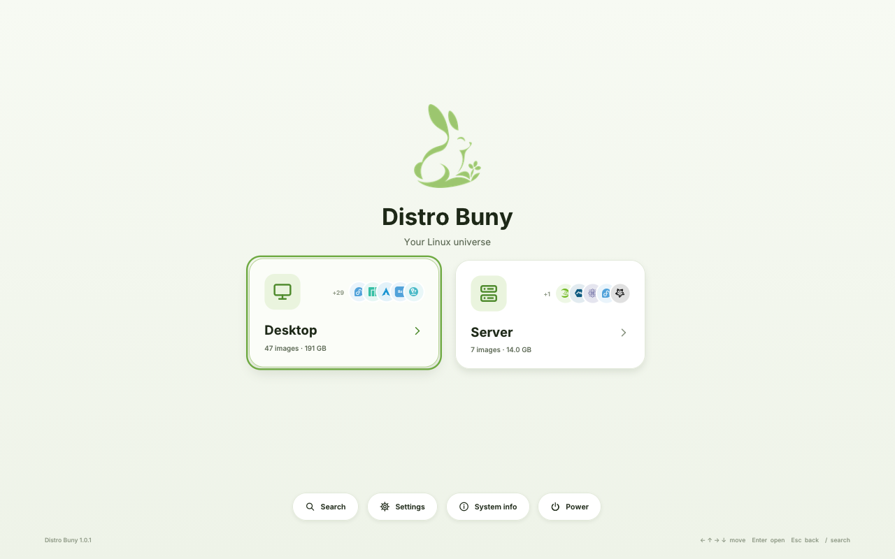

# Distro Buny

**A graphical multiboot USB drive for Linux ISO images.**

Copy unmodified `.iso` files into folders on one USB drive; start any computer
from it and choose a system from a modern, mouse- and keyboard-driven menu.
Distro Buny is an original implementation: no Ventoy, Easy2Boot or YUMI code,
binaries or formats.



## What it does

* **Automatic discovery.** Every `.iso` on the drive appears with its
  distribution, version, edition, size and mark. The folder tree is the menu:
  `Desktop`, `Servers` and any folders you create, nested up to 12 levels deep,
  with breadcrumbs and Back navigation.
* **Real boots.** The selected system's own kernel and initrd are started
  with kexec. The ISO is presented to the system as a read-only virtual disc,
  so live systems and installers find their medium as if they had their own
  USB stick. Distribution adapters cover the Ubuntu (casper), Arch, Manjaro,
  Fedora/dracut, Anaconda, openSUSE (KIWI and linuxrc), Debian (installer and
  live), antiX/MX, Slackware, NixOS and Guix families, plus generic
  `loopback.cfg` images and a best-effort start for other 64-bit Linux images.
* **Verified compatibility.** In QEMU/OVMF all 54 test images reached user
  space or their installer: Ubuntu and flavours, Mint, Pop!\_OS, Zorin,
  Fedora editions, Bazzite, Nobara, AlmaLinux, CentOS Stream, Arch,
  EndeavourOS, CachyOS, Omarchy, BlackArch, Manjaro, openSUSE, Debian
  (installer), Kali, Parrot, MX Linux, antiX, Slackware, Alpine, NixOS, Void,
  Gentoo and Guix. Not yet tested on real computers. See
  [COMPATIBILITY.md](documentation/COMPATIBILITY.md).
* **Secure Boot without shortcuts.** It starts on Secure Boot machines
  (Microsoft → Canonical-signed chain). With Secure Boot on, it starts the
  kernels the machine trusts and clearly marks the others. It never bypasses
  Secure Boot.
* **Large drives.** An exFAT data partition (readable and writable from
  Windows, macOS and Linux, no 4 GiB file limit) fills the drive. The
  1.0.0 reference image held 45 ISOs, 169.7 GiB.
* **Safe tools.** An installer that refuses system disks and makes you type
  the drive name, and an updater that only installs ISO images whose
  checksums are signed by the vendor's pinned key.

## Download

The **starter image** `distrobuny-1.0.1-starter.img.xz` (about 39 MiB, 3.5
GiB unpacked) is a ready Distro Buny drive without ISO files. Write it to a
USB stick of 4 GB or more with balenaEtcher or Rufus (it is a disk image, so
Rufus uses DD mode), then copy your own `.iso` files into the `Desktop` or
`Servers` folder of the stick's DISTROBUNY drive from any computer. On a
stick bigger than 4 GB, the menu offers to grow DISTROBUNY to the whole stick
the first time you start from it (a few seconds, nothing is erased). Step by
step: [USER_GUIDE.md §2.1](documentation/USER_GUIDE.md) and the *User Guide*
PDF in the download.

No ISO files are distributed with Distro Buny: they belong to their
publishers. The download's *Licenses and source code* folder carries the
complete source code of all GPL and LGPL software in the image, and
`SOURCE-CODE.txt` explains it. Distro Buny itself is free software under the
GNU GPL, version 3 or later (`COPYING`); see `CHANGELOG.md` for what changed.

## Quick start (build it yourself)

```bash
make -j"$(nproc)"                                   # host tools
tools/build/buny-build runtime                      # signed kernel + runtime initramfs
tools/build/buny-build esp                          # EFI boot partition contents
tools/maintenance/buny-install list                 # find your USB drive
sudo tools/maintenance/buny-install create --isos ~/ISOs --target sdX
```

Or build a disk image (`tools/build/buny-build image --profile full`) and try
it in a virtual machine window with `tools/development/buny-vm`. The
download is made with `buny-build image --profile starter` and
`buny-build release` ([BUILD_INSTRUCTIONS.md §9](documentation/BUILD_INSTRUCTIONS.md)).

## Documentation

| Document | Contents |
| --- | --- |
| [USER_GUIDE.md](documentation/USER_GUIDE.md) | installing, adding ISOs, using the menu, Secure Boot, updates, troubleshooting |
| [BUILD_INSTRUCTIONS.md](documentation/BUILD_INSTRUCTIONS.md) | requirements, build steps, reproducible builds, tests |
| [ARCHITECTURE.md](documentation/ARCHITECTURE.md) | boot chain, runtime, virtual medium, adapters, interface, tools |
| [DEVELOPER_GUIDE.md](documentation/DEVELOPER_GUIDE.md) | code layout, conventions, adding distributions and update sources |
| [COMPATIBILITY.md](documentation/COMPATIBILITY.md) | per-image results with and without Secure Boot |
| [TEST_RESULTS.md](documentation/TEST_RESULTS.md) | all automated and virtual-machine test results |
| [SECURITY.md](documentation/SECURITY.md) | threat model, Secure Boot, privilege separation, update and installer safety |
| [FUTURE_DEVELOPMENT.md](documentation/FUTURE_DEVELOPMENT.md) | what comes next |
| [REPORT.md](documentation/REPORT.md) | the engineering report |

## Licensing

Distro Buny's own code is GPL-3.0-or-later. It ships unmodified third-party
components under their own licences: shim (BSD-2-Clause), GRUB 2
(GPL-3.0-or-later), the Linux kernel and modules (GPL-2.0-only), BusyBox
(GPL-2.0-only), the GNU C Library (LGPL-2.1-or-later, linked statically into
the runtime programs), the Inter typeface (SIL OFL 1.1), stb_truetype
(public domain / MIT) and distribution marks from Simple Icons (CC0
collection; some marks carry their own licence, listed in
`assets/distro-icons/ATTRIBUTION.md`). Distribution names and logos are
trademarks of their owners and are used only to identify the corresponding
images. Every image carries these notices in `distrobuny/LICENSES.txt`, and
the full licence texts in `distrobuny/licenses/`, on its boot partition. The
exact Ubuntu source packages are pinned in
`configuration/boot/components.json` and listed in each release's
`SOURCE-CODE.txt`. Details are in [REPORT.md §24](documentation/REPORT.md).
