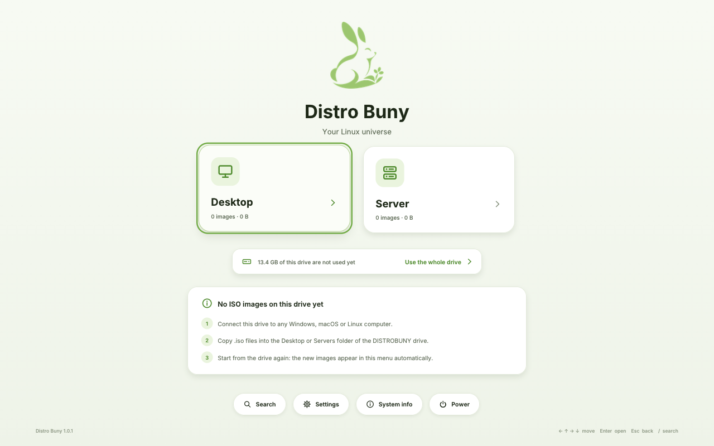

# Distro Buny — User Guide

Distro Buny turns one USB drive into a boot menu for many Linux systems. You
copy ordinary `.iso` files onto the drive; when a computer starts from the
drive, Distro Buny shows them as cards and starts the one you choose.

## 1. What you need

* A 64-bit PC with UEFI firmware (practically every PC from 2012 on). Legacy
  BIOS-only machines are not supported.
* A USB drive (or SD card): 4 GB or more for the starter image, or, with the
  installer, at least as large as the ISO files you want plus about 1 GiB.
* Any Windows, macOS or Linux computer to write the starter image with
  balenaEtcher or Rufus (section 2.1), or a Linux computer for the installer
  (section 2.2). After that you can add ISOs from Windows, macOS or Linux.

## 2. Putting Distro Buny on a USB drive

Everything on the drive is erased.

### 2.1 The starter image (Windows, macOS or Linux)

The download `distrobuny-1.0.1-starter.img.xz` (about 39 MiB) is a complete
Distro Buny drive without any ISO files: the boot chain, the menu, and empty
`Desktop` and `Servers` folders. It unpacks to a 3.5 GiB disk image, which
fits every stick sold as "4 GB".

1. Check the download against `SHA256SUMS` (optional but recommended):
   `Get-FileHash` in Windows PowerShell, `shasum -a 256` on macOS, or
   `sha256sum -c --ignore-missing SHA256SUMS` on Linux.
2. Write it to the stick **as a disk image**:
   * **balenaEtcher** (Windows, macOS, Linux): *Flash from file* → choose
     the `.img.xz` file (no need to unpack it) → *Select target* → the stick
     → *Flash!*.
   * **Rufus** (Windows): choose the stick under *Device*, then *SELECT* the
     `.img.xz` file. Rufus recognises a disk image and writes it in DD mode
     by itself (the partition scheme and file system fields are greyed out);
     if it ever asks, choose *DD Image* mode, never *ISO Image* mode. Then
     *START*.
   * **Linux terminal**: `xz -dc distrobuny-1.0.1-starter.img.xz | sudo dd
     of=/dev/sdX bs=4M conv=fsync status=progress`, with `sdX` the stick
     (check with `lsblk`: the wrong name destroys that drive's data).

   Do not copy the image file onto the stick, and do not let Windows format
   the stick afterwards (choose *Cancel* if it asks).
3. On a stick bigger than 4 GB, let Distro Buny use the whole stick (see
   *Using the whole stick* below).
4. Add your ISO files as described in section 3. Until you do, the menu
   shows how:

   

#### Using the whole stick

balenaEtcher, Rufus and `dd` copy the 3.5 GiB image as it is. On a bigger
stick, the DISTROBUNY partition at first holds about **3.0 GiB**, and the rest
of the stick is not used yet. Distro Buny fixes this from its menu:

1. Start a computer from the stick (section 4). Below the categories, the
   menu shows *"13.4 GB of this drive are not used yet — Use the whole
   drive"* (with your stick's numbers):

   
2. Choose it. A dialog shows DISTROBUNY's current and new size. Choose
   **Expand DISTROBUNY**. The focus starts on *Cancel*, so an accidental
   Enter changes nothing.
3. Wait a few seconds until the menu says *The drive now uses all of its
   space*. Do not unplug the stick or switch off the computer before then.

Nothing on the stick is erased or moved. ISO files you already copied stay
where they are, and the boot partition is not touched. Distro Buny only
rewrites the partition table and the file system's own bookkeeping, in an
order that survives a power cut. If the computer loses power in the middle,
start it from the stick again: Distro Buny finishes the expansion before the
menu appears. If the power failed before anything had changed, the menu
simply offers the expansion again. If you plug such a stick into Windows
first, it may offer to scan and fix the drive. Let it; nothing is lost.

You can expand the drive before or after copying ISO files. Until you do,
Windows, macOS and Linux see a DISTROBUNY drive of about 3.0 GiB, so an
image larger than that needs the expansion first. DISTROBUNY grows to at
most 2 TiB.

The menu explains why instead of offering the expansion when it cannot
grow the drive safely:

* **The drive was not ejected safely** the last time another computer used
  it. Connect it to a Windows, macOS or Linux computer, let that system check
  it, eject it properly, then start from it again.
* **The boot partition lies behind DISTROBUNY.** Drives written from an image
  with the earlier layout cannot grow. Copy your ISO files off the drive,
  write the current starter image, and expand it.
* **DISTROBUNY was formatted again** (for example by Windows) or is damaged.
  Only Distro Buny's own exFAT file system can grow. Write the starter image
  again.

The installer (section 2.2) builds drives whose data partition already
fills the drive.

### 2.2 The installer (Linux)

The installer never chooses a drive by itself and refuses drives that look
like part of your computer. It can make the data partition fill the whole
drive.

1. Plug in the USB drive. If your desktop opens it, eject or unmount it (but
   leave it plugged in).
2. Find its name:

   ```bash
   tools/maintenance/buny-install list
   ```

   The list shows every drive and whether it can be used. Your internal disk
   is always marked *refused*, with the reason.
3. Either build the drive straight from a folder of ISO files (the data
   partition fills the whole drive):

   ```bash
   sudo tools/maintenance/buny-install create --isos ~/ISOs --target sdb
   ```

   or copy a finished Distro Buny image, such as the starter image (its
   data partition keeps the image's size until you expand it from the
   menu, section 2.1):

   ```bash
   sudo tools/maintenance/buny-install write --image output/images/distrobuny-1.0.1-starter.img --target sdb
   ```
4. The tool shows the drive's model, size and partitions and asks you to type
   its name (`sdb`) to confirm. It then writes the drive, reads everything
   back to check it, and tells you when you can unplug it.

## 3. Adding and organising ISO files

The drive has a partition called **DISTROBUNY** that any computer can open.
It starts with two folders:

* `Desktop`: systems for laptops and workstations
* `Servers`: server and headless systems

Copy `.iso` files into them. **Folders become the menu**: create
`Desktop/Ubuntu Family` and it appears as a page inside *Desktop*. You can
nest folders up to 12 levels deep and add new top-level folders (for example
`Rescue` or `Gaming`). Well-known folder names get a matching icon.

Tips:

* Copy ISO files whole and unmodified; do not extract them.
* Safely eject the drive before unplugging it, so the copy is complete.
* The menu notices new or changed files on its next start and examines them
  in the background.
* While the drive (or a folder) holds no ISO files, the menu shows these
  steps instead of an empty page.
* Do not edit or delete the hidden `.distrobuny` folder.

## 4. Starting a computer from the drive

1. Plug the drive in and switch the computer on.
2. Open the firmware's boot menu (often **F12**, **F11**, **F10**, **Esc** or
   **F8** right after power-on) and choose the USB drive. On Macs with Intel
   processors hold **Option**.
3. After a few seconds the Distro Buny menu appears.

### Using the menu

| Action | Keyboard | Mouse / touchpad |
| --- | --- | --- |
| Move between items | arrow keys, Tab / Shift+Tab | point |
| Open a folder or image | Enter or Space | click |
| Go back | Esc or Backspace | ← button, right-click, or a breadcrumb |
| Go to the start page | Home | "Home" breadcrumb |
| Search | just start typing (or `/`) | search button |
| Scroll | Page Up / Page Down | wheel, two-finger scroll |
| Power menu | F10 | power button on the start page |

Every image card shows the distribution, version, size and a status badge:

| Badge | Meaning |
| --- | --- |
| **Verified** | This exact image (same label and size) booted in the Distro Buny test lab. |
| **Ready** | Distro Buny knows how to start this image. |
| **Best effort** | A Linux family Distro Buny does not know yet. It tries the image's own boot entry with the virtual disc and asks you first; if the system stops with an error, restart the computer. |
| **Needs Secure Boot off** | Secure Boot is on and this system's kernel is not signed with a key the computer trusts (see section 6). |
| **Erases a disk** | A self-installing image, or one that installs a system automatically without asking (Ubuntu `autoinstall`, a kickstart that partitions, Debian preseeding). You will be asked to confirm. |
| **Known issue** | This image failed in the test lab; the details page says why. |
| **Not supported** | Distro Buny cannot start this image (for example a Windows, ARM or 32-bit ISO); the details page says why. *Show unsupported images* in Settings hides such cards. |
| **Damaged** | The file is not a readable ISO image (often an incomplete copy). |

Open an image to see its details (version, edition, kernel, signature, how it
will be started, lab-test result) and press **Start**. **Boot options**
offers:

* **Entry**: the image's own menu entries (for example "Try or Install" or
  "Safe graphics").
* **Safe graphics**: adds `nomodeset` for graphics cards that show a black
  screen.
* **Media**: *Automatic* (recommended), *Virtual medium* or *Native ISO file*
  (section 5).

If a system cannot be started, a dialog explains why and offers *Try again*.

### Settings

Settings are stored on the drive and apply on every computer:

* **Appearance**: light or dark theme
* **Animations**: on or off
* **Interface size**: automatic, or a fixed scale for very small or large screens
* **Show unsupported images**
* **Remember the last started system**: adds a one-click shortcut to the start page
* **Boot media**: the default media strategy
* **Technical details**: shows boot parameters and medium diagnostics on image pages

The *About* page shows the version, display and input devices, the firmware's
Secure Boot state and the drive.

## 5. How images are started

Distro Buny reads the chosen system's kernel straight from the ISO file and
starts it. Most Linux systems expect to find their installation medium as a
DVD or USB stick, so Distro Buny presents the ISO file as exactly that, a
read-only virtual disc (the **virtual medium**). The system then boots as if
it had been written to its own USB stick. Nothing on the drive is changed.

Some systems can also open an ISO file on a partition by themselves
(**native ISO file**). Distro Buny uses that only when you choose it under
Boot options.

## 6. Secure Boot

Distro Buny starts with Secure Boot **on or off**; you do not have to change
anything to start the drive itself (its boot chain is signed, Microsoft →
Canonical). Secure Boot only decides which systems the menu can start:

* **Secure Boot off:** every supported system starts (all 54 images of the test lab).
  This is the simplest choice if you use many different distributions.
* **Secure Boot on:** only systems whose kernel is signed with a key Distro
  Buny's runtime trusts can start. In practice that is the Ubuntu family:

Even distributions that support Secure Boot from their own DVD (Fedora,
openSUSE) cannot be started through Distro Buny with Secure Boot on: their
kernels are signed by their own keys, which Distro Buny's Ubuntu-signed
runtime does not trust. With Secure Boot on:

* Ubuntu and its flavours, and systems that use Ubuntu's kernel, start normally.
* Systems with unsigned kernels (for example Arch Linux, Void, Gentoo, NixOS
  and Guix) are marked **Needs Secure Boot off**. Starting one shows a dialog
  that can restart directly into the firmware settings, where you can switch
  Secure Boot off.
* Other signed distributions are covered in `COMPATIBILITY.md`, which lists
  exactly what was tested.

Distro Buny never bypasses Secure Boot. `SECURITY.md` explains why, and how
to enrol a key with the MOK manager (*Esc* at start-up → *Advanced options*)
if you manage your own keys.

## 7. Keeping ISO images up to date

On a Linux computer, with the drive plugged in and mounted:

```bash
tools/maintenance/buny-update status      # what is on the drive and where updates come from
tools/maintenance/buny-update check       # look for newer releases
tools/maintenance/buny-update update      # download, verify and (after you agree) replace
```

Updates are downloaded onto the drive itself, checked against the vendor's
signed checksums, and only then put in place of the old image. If anything
goes wrong, the old image stays as it was. `--keep-old` keeps the previous
version next to the new one.

## 8. Troubleshooting

| Problem | What to try |
| --- | --- |
| The computer does not offer the USB drive | Enable USB boot / UEFI boot in the firmware; try another USB port; on very old PCs disable "CSM/Legacy only". |
| "Secure Boot blocked this system" | Choose *Restart into firmware settings* and switch Secure Boot off, or pick a signed distribution. |
| Black screen after starting a system | Boot options → *Safe graphics*. |
| A newly copied ISO shows **Damaged** | The copy is incomplete. Copy it again and eject the drive properly. |
| "the file is fragmented" | Copy the ISO again onto the drive (a fresh copy is usually contiguous), or free some space first. |
| The menu says no Distro Buny drive was found | Wait a moment or re-plug the drive and choose *Search again*. Card readers and hubs can be slow. |
| DISTROBUNY shows only 3.0 GiB on a bigger stick | Start from the stick and choose *Use the whole drive* on the menu's home page (section 2.1). If the menu says why it cannot, follow its advice. |
| The power failed while the drive was being expanded | Start from the stick again: Distro Buny finishes the expansion before the menu appears. |
| Something else | *Esc* at start-up → *Distro Buny (diagnostic mode)* shows detailed messages; the menu's log page lists recent events. |

## 9. Limits

* UEFI x86-64 only; no legacy BIOS, no 32-bit or ARM systems.
* A drive written from the starter image starts with a 3.0 GiB DISTROBUNY
  partition. The menu grows it to the whole stick (section 2.1), up to
  2 TiB.
* **Debian's installer** (netinst, DVD) starts like any other image. Distro
  Buny gives it the loop driver from the image itself, so it finds its
  installation medium as a CD drive (tested with Debian 13.7.0 netinst).
  Debian *live* images use the same live system as Kali and Parrot, which
  were tested; a Debian live ISO itself was not.
* **Slackware**: the installer starts normally. When `setup` asks for the
  source, choose *Install from a Slackware CD or DVD*, then *manual* and
  *custom*, and type `/dev/loop200` (Distro Buny's virtual DVD; the image's
  page in the menu says the same).
* Very old kernels (5.10 and earlier, for example antiX) are started without
  UEFI runtime services (`efi=noruntime`), because they crash otherwise; an
  installer started this way cannot add a firmware boot entry, so choose the
  "removable"/fallback boot location if it asks.
* Red Hat Enterprise Linux uses the same installer as CentOS Stream and
  AlmaLinux, which were tested; RHEL itself was not (it needs a Red Hat
  account).
* Self-installing images (badge **Erases a disk**) cannot tell which drive
  they were started from. Choose their target disk carefully.
* Windows ISOs are not supported.
